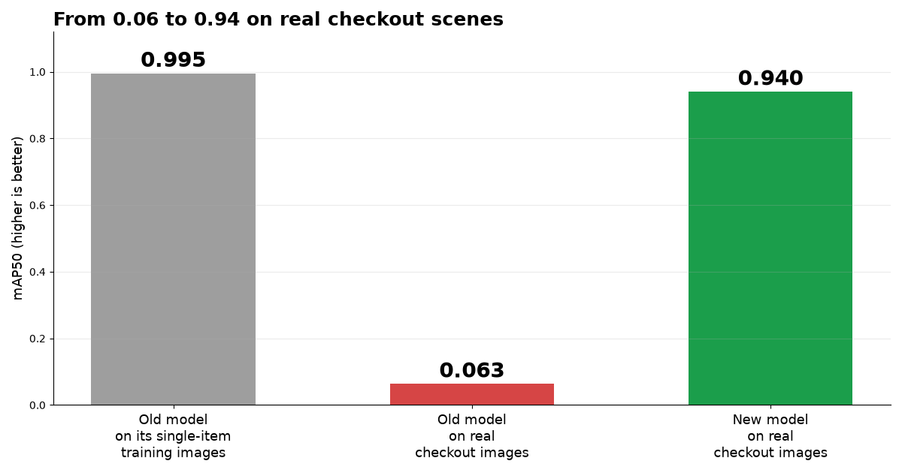
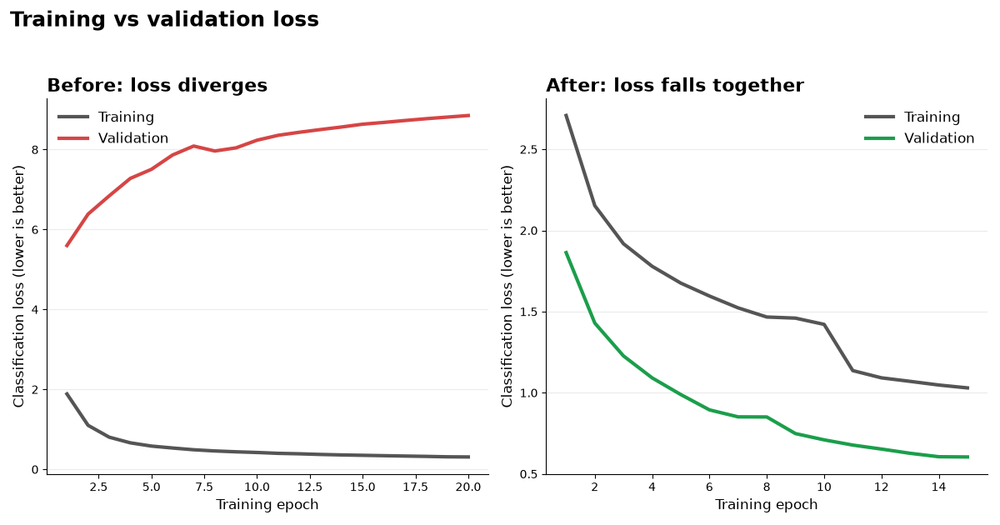

# Retail Checkout Product Detector (YOLO11 + synthetic scenes)

Detects 17 categories of grocery products (drinks, snacks, tissue, ...) in photos of a crowded
checkout counter, using YOLO11 trained on the [RPC dataset](https://rpc-dataset.github.io/).



## Results

| Model | Evaluated on | mAP50 |
|---|---|---|
| First model (single-item training images only) | its own training images | 0.995 |
| First model | real checkout images | 0.063 |
| **Final model (synthetic scenes)** | **4,000 held-out real checkout images** | **0.940** |

The final model also reaches mAP50-95 of 0.734. Scores use YOLO11n at 640 px.
Stage 1 of the training pipeline (frozen backbone, 15 epochs) produced these numbers.
Stage 2 (full fine-tuning) is implemented in the script but is not part of the reported results.

## The problem

The first model scored 0.995 mAP50 on its training photos but only 0.063 on real checkout
photos. Tuning the learning rate (0.001 and 0.0003), batch size and augmentation strength did
not help, because the cause was a **domain gap**, not the settings:

- RPC training photos: **one product** on a plain background
- RPC checkout photos: **about 12 overlapping products** per scene



## The fix

`make_synthetic_rpc.py` builds crowded training scenes from the single-item photos:

1. Cuts each product out of the single-item images (GrabCut, seeded with the labelled box).
2. Pastes 6 to 18 cutouts per 640x640 scene, with random scale, rotation, flip, colour jitter
   and overlap, on randomized backgrounds. Labels are generated automatically from the visible
   part of each item (mostly hidden items are dropped).
3. Builds the final training mix: 4,000 synthetic scenes + 4,000 real single-item images +
   2,000 real checkout images. The other 4,000 real checkout images are held out for validation.

`train_yolo_rpc_exp5.py` then trains in two stages: stage 1 freezes the backbone and uses strong
augmentation; stage 2 (optional) unfreezes everything at a lower learning rate.

## How to run

```bash
pip install -r requirements.txt

# 1. Download RPC and place it in archive/retail_product_checkout/ (train2019, val2019, test2019
#    folders plus the instances_*.json files), then convert the labels to YOLO format:
python convert_rpc_coco_to_yolo.py

# 2. Build the synthetic scenes and the dataset yaml
python make_synthetic_rpc.py

# 3. Train (stage 1 only; add --stage all to include fine-tuning)
python train_yolo_rpc_exp5.py --stage 1 --epochs1 15

# 4. Optional: train-vs-val diagnostic and graphs
python train_yolo_rpc_exp5.py --diagnose --diag-weights weights/final_rpc_model.pt
python make_graphs.py
```

Quick prediction with the included weights:

```bash
yolo predict model=weights/final_rpc_model.pt source=your_image.jpg conf=0.25 save=True
```

## Repository contents

| File | Purpose |
|---|---|
| `convert_rpc_coco_to_yolo.py` | RPC COCO json to YOLO labels (17 meta-categories) |
| `make_synthetic_rpc.py` | Cutouts, synthetic scenes, dataset lists and yaml |
| `train_yolo_rpc_exp5.py` | Two-stage training, resume and diagnostic |
| `make_graphs.py` | Result graphs from the Ultralytics `results.csv` files |
| `retail_checkout.yaml` | Class names for the 17 categories |
| `weights/final_rpc_model.pt` | Trained model (stage 1, best epoch) |

The dataset itself is not included. Check the RPC license before any commercial use.

## Limitations and next steps

- The model recognizes 17 product **categories**, not individual products or prices.
- Validation images come from the RPC checkout camera. Phone photos will be a new domain
  and will likely need extra training data.
- 2,000 real checkout images from the same pool were used for training. The official RPC test
  split has not been evaluated yet.
- Next: a phone-photo web app that returns annotated images with a count per category.
